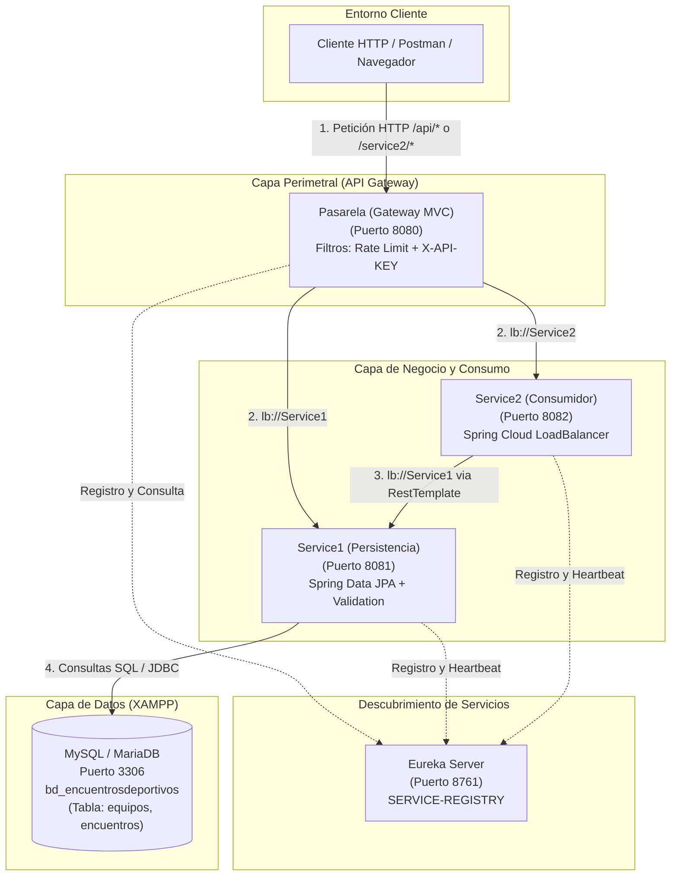

# GUÍA DIDÁCTICA: ARQUITECTURA DE MICROSERVICIOS CON BASE DE DATOS REAL Y RESTRICCIONES EN API GATEWAY

Esta guía documenta detalladamente la implementación, configuración, ejecución y validación de una arquitectura de microservicios desarrollada con **Java 17**, **Spring Boot**, **Spring Cloud (Eureka y Gateway MVC)**, **Spring Data JPA** y **MySQL/MariaDB (XAMPP)**.

---

## 1. ARQUITECTURA FINAL

La solución se compone de cuatro aplicaciones Spring Boot autónomas e independientes, que interactúan con un motor de base de datos relacional y un servidor de descubrimiento centralizado:



### Flujo de Comunicación:
1. **Petición Directa a Datos:** `Cliente` → `Pasarela (8080)` → `Service1 (8081)` → `MySQL (3306)`.
2. **Petición Orquestada / Consumo:** `Cliente` → `Pasarela (8080)` → `Service2 (8082)` → `Service1 (8081)` → `MySQL (3306)`.
3. **Descubrimiento Dinámico:** Todos los microservicios se registran en `Eureka Server (8761)` con su identificador (`SERVICE1`, `SERVICE2`, `PASARELA`), permitiendo que el balanceador resuelva dinámicamente direcciones IP y puertos sin direcciones rígidas.

---

## 2. FUNCIÓN DE CADA MICROSERVICIO

### A. Eureka Server (`eureka-server` - Puerto 8761)
- **Rol:** Servidor de registro y descubrimiento (*Service Discovery*).
- **Responsabilidad:** Mantiene el catálogo en tiempo real de las instancias activas y sus direcciones de red. Gestiona heartbeats y renovación de leases.
- **Configuración clave:** `register-with-eureka=false` y `fetch-registry=false` ya que actúa como servidor y no como cliente de sí mismo.

### B. Service1 (`Service1` - Puerto 8081)
- **Rol:** Microservicio de persistencia y dominio (*Data Provider*).
- **Responsabilidad:** Es el **único** microservicio con conexión directa a la base de datos `bd_encuentrosdeportivos`.
- **Funcionalidades:**
  - CRUD completo para la entidad `Equipo` (`/api/equipos`).
  - Validaciones de negocio (`@NotBlank`, `@Size`, nombres duplicados).
  - **Manejo seguro de integridad referencial:** Antes de eliminar un equipo, verifica si existen partidos asociados en la tabla `encuentros`. Si existen, rechaza la operación con código `409 Conflict` para proteger el historial de partidos.
  - Mantiene intactos los endpoints previos (`/service1`).

### C. Service2 (`Service2` - Puerto 8082)
- **Rol:** Microservicio consumidor / agregador (*API Consumer*).
- **Responsabilidad:** No tiene acceso a base de datos. Consume los recursos de `Service1` mediante peticiones REST.
- **Funcionalidades:**
  - Utiliza `RestTemplate` anotado con `@LoadBalanced` y **Spring Cloud LoadBalancer**.
  - Resuelve las llamadas usando la URL lógica `http://Service1/api/equipos` (descubierta mediante Eureka).
  - Maneja caídas o respuestas de error de `Service1`.
  - Mantiene intactos los endpoints previos (`/service2`).

### D. Pasarela (`Pasarela` - Puerto 8080)
- **Rol:** Puerta de enlace perimetral (*API Gateway* con Spring Cloud Gateway MVC).
- **Responsabilidad:** Punto único de entrada para clientes externos (Postman, Frontend, etc.).
- **Funcionalidades:**
  - Enrutamiento dinámico mediante `lb://Service1` y `lb://Service2`.
  - Implementación de **Filtro de Seguridad y Restricciones** (`GatewaySecurityAndRateLimitFilter`):
    - **Restricción 1:** Limitación de tasa (Rate Limiting) para solicitudes `GET`.
    - **Restricción 2:** Autenticación por clave (`X-API-KEY`) para operaciones de modificación (`POST`, `PUT`, `PATCH`, `DELETE`).
  - Controlador de reinicio administrativo de contadores (`/api/rate-limit/reset`).

---

## 3. CONFIGURACIÓN DE XAMPP Y BASE DE DATOS

### Estado de XAMPP:
1. Abrir el **Panel de Control de XAMPP**.
2. Iniciar el servicio **MySQL** (puerto por defecto `3306`).
3. Ingresar a phpMyAdmin en `http://localhost/phpmyadmin`.

### Base de Datos: `bd_encuentrosdeportivos`
El microservicio reutiliza la base de datos existente del proyecto `sistemaFutbol` sin alterar su estructura:

#### Tabla `equipos`:
| Columna | Tipo | Restricción | Descripción |
|---|---|---|---|
| `id` | BIGINT | PRIMARY KEY, AUTO_INCREMENT | Identificador único del equipo |
| `nombre` | VARCHAR(100) | NOT NULL, UNIQUE | Nombre del club |
| `ciudad` | VARCHAR(100) | NOT NULL | Ciudad de origen |
| `estadio` | VARCHAR(150) | NULL | Nombre del estadio (opcional) |
| `created_at` | TIMESTAMP | DEFAULT CURRENT_TIMESTAMP | Fecha/hora de registro |

#### Tabla `encuentros`:
Contiene las claves foráneas hacia `equipos(id)`:
- `equipo_local_id`
- `equipo_visitante_id`

> [!CAUTION]
> La tabla `encuentros` tiene una restricción `ON DELETE CASCADE`. Para no eliminar partidos reales accidentalmente al borrar un equipo, `Service1` implementa una verificación programática antes del borrado.

### Configuración en `Service1/src/main/resources/application.properties`:
```properties
spring.datasource.url=jdbc:mysql://localhost:3306/bd_encuentrosdeportivos?useSSL=false&serverTimezone=UTC&allowPublicKeyRetrieval=true
spring.datasource.username=${DB_USERNAME:root}
spring.datasource.password=${DB_PASSWORD:}
spring.datasource.driver-class-name=com.mysql.cj.jdbc.Driver

# Configuración Hibernate segura (no modifica tablas existentes)
spring.jpa.hibernate.ddl-auto=none
spring.jpa.database-platform=org.hibernate.dialect.MySQLDialect
spring.jpa.properties.hibernate.dialect=org.hibernate.dialect.MySQLDialect
spring.jpa.show-sql=true
```

---

## 4. DEPENDENCIAS AGREGADAS

### En `Service1/pom.xml`:
```xml
<!-- Persistencia JPA con Hibernate -->
<dependency>
    <groupId>org.springframework.boot</groupId>
    <artifactId>spring-boot-starter-data-jpa</artifactId>
</dependency>

<!-- Driver oficial de MySQL / MariaDB -->
<dependency>
    <groupId>com.mysql</groupId>
    <artifactId>mysql-connector-j</artifactId>
    <scope>runtime</scope>
</dependency>

<!-- Validaciones Bean Validation (JSR 380) -->
<dependency>
    <groupId>org.springframework.boot</groupId>
    <artifactId>spring-boot-starter-validation</artifactId>
</dependency>
```

### En `Service2/pom.xml`:
```xml
<!-- Soporte de Balanceo de Carga para llamadas entre microservicios -->
<dependency>
    <groupId>org.springframework.cloud</groupId>
    <artifactId>spring-cloud-starter-loadbalancer</artifactId>
</dependency>
```

### En `Pasarela/pom.xml`:
Mantiene `spring-cloud-starter-gateway-mvc` y `spring-cloud-starter-netflix-eureka-client`. Las restricciones fueron implementadas mediante filtros estándar de Servlet (`OncePerRequestFilter`), completamente compatibles con el modelo síncrono/MVC sin requerir WebFlux.

---

## 5. CATÁLOGO COMPLETO DE ENDPOINTS

Todas las peticiones externas deben realizarse a través de la **Pasarela (puerto 8080)**:

| Método | Endpoint en Pasarela | Microservicio Destino | Requiere `X-API-KEY` | Sujeto a Rate Limit | Descripción |
|---|---|---|:---:|:---:|---|
| `GET` | `/api/equipos` | `Service1` | No | Sí (máx 2) | Lista todos los equipos de la base de datos |
| `GET` | `/api/equipos/{id}` | `Service1` | No | Sí (máx 2) | Obtiene un equipo por su ID |
| `POST` | `/api/equipos` | `Service1` | **Sí** | No | Registra un nuevo equipo |
| `PUT` | `/api/equipos/{id}` | `Service1` | **Sí** | No | Actualiza un equipo existente |
| `DELETE`| `/api/equipos/{id}` | `Service1` | **Sí** | No | Elimina un equipo (si no tiene encuentros) |
| `GET` | `/service2/equipos` | `Service2` → `Service1` | No | Sí (máx 2) | Obtiene equipos consumiendo Service1 |
| `GET` | `/service2/equipos/{id}` | `Service2` → `Service1` | No | Sí (máx 2) | Obtiene un equipo específico vía Service2 |
| `POST` | `/api/rate-limit/reset` | `Pasarela` (Interno) | No | No | Reinicia los contadores del Rate Limiter |
| `GET` | `/api/rate-limit/status` | `Pasarela` (Interno) | No | No | Consulta el estado actual de los contadores |
| `GET` | `/service1` | `Service1` | No | Sí (máx 2) | Endpoint heredado de Service1 |
| `GET` | `/service2` | `Service2` | No | Sí (máx 2) | Endpoint heredado de Service2 |

---

## 6. EXPLICACIÓN DE LAS DOS RESTRICCIONES EN LA PASARELA

Las restricciones se ejecutan en la clase `GatewaySecurityAndRateLimitFilter` con prioridad máxima (`@Order(Ordered.HIGHEST_PRECEDENCE)`).

### Restricción 1: Límite de Solicitudes GET (Rate Limiting)
- **Regla:** Un mismo cliente puede ejecutar un máximo de **2 peticiones GET** consecutivas a una misma ruta dentro de una ventana de **60 segundos**.
- **Comportamiento en la 3ra petición:** Se bloquea la solicitud y se devuelve inmediatamente un código HTTP **`429 Too Many Requests`**.
- **Cuerpo de respuesta HTTP 429:**
  ```json
  {
    "timestamp": "2026-10-17T18:20:00",
    "status": 429,
    "error": "Too Many Requests",
    "message": "Se ha superado el limite permitido de 2 solicitudes GET para esta ruta. Intente nuevamente en 60 segundos.",
    "path": "/api/equipos",
    "limit": 2,
    "windowSeconds": 60
  }
  ```
- **Identificación del cliente:** Se utiliza la dirección IP remota (`request.getRemoteAddr()`) combinada con el `URI` solicitado.
- **Reinicio administrativo:** Para facilitar las demostraciones universitarias, se puede enviar una petición `POST http://localhost:8080/api/rate-limit/reset` para poner los contadores a cero de inmediato.

### Restricción 2: Protección de Operaciones de Escritura (API Key)
- **Regla:** Toda solicitud con método **`POST`**, **`PUT`**, **`PATCH`** o **`DELETE`** (excepto las rutas administrativas de rate-limit) debe incluir obligatoriamente la cabecera:
  ```http
  X-API-KEY: admin123
  ```
- **Configuración:** La clave se define mediante la variable de entorno `GATEWAY_API_KEY` o toma el valor por defecto seguro `admin123`.
- **Comportamiento si falta o es inválida:** La pasarela rechaza la petición con código HTTP **`401 Unauthorized`**.
- **Cuerpo de respuesta HTTP 401:**
  ```json
  {
    "timestamp": "2026-10-17T18:20:00",
    "status": 401,
    "error": "Unauthorized",
    "message": "Operacion de escritura no autorizada. Debe proporcionar una cabecera 'X-API-KEY' valida.",
    "path": "/api/equipos"
  }
  ```

> [!NOTE]
> Estas restricciones son mecanismos académicos demostrativos para evaluar filtros y enrutamiento en un API Gateway, no reemplazan una arquitectura OAuth2 / JWT en producción.

---

## 7. INSTRUCCIONES PARA EJECUTAR EL PROYECTO

### Prerrequisitos:
1. Java Development Kit (JDK 17 o superior instalado y configurado en el `PATH`).
2. Apache Maven (`mvn -version`).
3. XAMPP con el módulo **MySQL** iniciado.

### Opción 1: Ejecución Automatizada (Recomendada)
En la raíz del proyecto se encuentra el script automatizado `iniciar-todo.bat`.

1. Haz doble clic en `iniciar-todo.bat` o ejecútalo desde tu consola en la carpeta raíz del proyecto:
   ```cmd
   cd ruta\hacia\PracticaMicroservicios
   iniciar-todo.bat
   ```
2. El script realiza automáticamente:
   - Verificación de la compilación de los 4 proyectos (`.jar` en cada carpeta `target/`).
   - Comprobación de conectividad TCP a MySQL en el puerto 3306.
   - Apertura de **Eureka Server** en una ventana independiente.
   - Sondeo periódico por HTTP hasta confirmar que Eureka está 100% operativo.
   - Apertura de **Service1**, **Service2** y **Pasarela** en ventanas separadas.

### Opción 2: Compilación y Ejecución Manual

Si necesitas compilar los proyectos desde cero:
```cmd
cd eureka-server && mvn clean package -DskipTests && cd ..
cd Service1 && mvn clean package -DskipTests && cd ..
cd Service2 && mvn clean package -DskipTests && cd ..
cd Pasarela && mvn clean package -DskipTests && cd ..
```

Para ejecutarlos individualmente (en consolas separadas y en este orden estricto):
1. **Eureka Server:**
   ```cmd
   java -jar eureka-server/target/eureka-server-0.0.1-SNAPSHOT.jar
   ```
   *(Esperar unos 10 segundos hasta ver "Started EurekaServerApplication")*
2. **Service1:**
   ```cmd
   java -jar Service1/target/Service1-0.0.1-SNAPSHOT.jar
   ```
3. **Service2:**
   ```cmd
   java -jar Service2/target/Service2-0.0.1-SNAPSHOT.jar
   ```
4. **Pasarela:**
   ```cmd
   java -jar Pasarela/target/Pasarela-0.0.1-SNAPSHOT.jar
   ```

---

## 8. PRUEBAS EN POSTMAN (GUÍA PASO A PASO)

A continuación se presentan los casos de prueba con ejemplos de solicitud, cabeceras, cuerpo y respuestas esperadas.

---

### Caso 1: Obtener lista de equipos vía Pasarela -> Service1
- **Método:** `GET`
- **URL:** `http://localhost:8080/api/equipos`
- **Cabeceras:** Ninguna requerida.
- **Código esperado:** `200 OK`
- **Ejemplo de respuesta:**
  ```json
  [
    {
      "id": 1,
      "nombre": "Cienciano",
      "ciudad": "Cusco",
      "estadio": "Inca Garcilaso de la Vega",
      "createdAt": "2026-10-17T17:15:30"
    },
    {
      "id": 2,
      "nombre": "Melgar",
      "ciudad": "Arequipa",
      "estadio": "Monumental de la UNSA",
      "createdAt": "2026-10-17T17:15:30"
    }
  ]
  ```

---

### Caso 2: Probar Restricción 1 (Rate Limit en GET)
1. Envía `GET http://localhost:8080/api/equipos` → Respuesta: `200 OK` (Petición 1).
2. Envía `GET http://localhost:8080/api/equipos` → Respuesta: `200 OK` (Petición 2).
3. Envía `GET http://localhost:8080/api/equipos` → Respuesta: **`429 Too Many Requests`** (Petición 3 - Bloqueada).

- **Ejemplo de respuesta HTTP 429:**
  ```json
  {
    "timestamp": "2026-10-17T18:22:15.123",
    "status": 429,
    "error": "Too Many Requests",
    "message": "Se ha superado el limite permitido de 2 solicitudes GET para esta ruta. Intente nuevamente en 60 segundos.",
    "path": "/api/equipos",
    "limit": 2,
    "windowSeconds": 60
  }
  ```

#### Reiniciar el contador para seguir probando:
- **Método:** `POST`
- **URL:** `http://localhost:8080/api/rate-limit/reset`
- **Respuesta:** `200 OK` con `{"status": "SUCCESS", "message": "Contadores de rate limit reiniciados correctamente."}`.

---

### Caso 3: Probar Restricción 2 (Escritura sin API Key)
- **Método:** `POST`
- **URL:** `http://localhost:8080/api/equipos`
- **Cabeceras:** `Content-Type: application/json` (Sin la cabecera `X-API-KEY`).
- **Body (raw JSON):**
  ```json
  {
    "nombre": "Sport Boys",
    "ciudad": "Callao",
    "estadio": "Miguel Grau"
  }
  ```
- **Código esperado:** **`401 Unauthorized`**
- **Respuesta:**
  ```json
  {
    "timestamp": "2026-10-17T18:23:00.456",
    "status": 401,
    "error": "Unauthorized",
    "message": "Operacion de escritura no autorizada. Debe proporcionar una cabecera 'X-API-KEY' valida.",
    "path": "/api/equipos"
  }
  ```

---

### Caso 4: Registro exitoso con API Key válida
- **Método:** `POST`
- **URL:** `http://localhost:8080/api/equipos`
- **Cabeceras:**
  - `Content-Type: application/json`
  - `X-API-KEY: admin123`
- **Body (raw JSON):**
  ```json
  {
    "nombre": "Sport Boys",
    "ciudad": "Callao",
    "estadio": "Miguel Grau"
  }
  ```
- **Código esperado:** **`201 Created`**
- **Respuesta:**
  ```json
  {
    "id": 8,
    "nombre": "Sport Boys",
    "ciudad": "Callao",
    "estadio": "Miguel Grau",
    "createdAt": "2026-10-17T18:24:10"
  }
  ```

---

### Caso 5: Actualizar equipo con PUT y API Key
- **Método:** `PUT`
- **URL:** `http://localhost:8080/api/equipos/8`
- **Cabeceras:**
  - `Content-Type: application/json`
  - `X-API-KEY: admin123`
- **Body (raw JSON):**
  ```json
  {
    "nombre": "Sport Boys del Callao",
    "ciudad": "Callao",
    "estadio": "Estadio Campolo Alcalde"
  }
  ```
- **Código esperado:** `200 OK`
- **Respuesta:** Objeto actualizado con los nuevos valores.

---

### Caso 6: Eliminar equipo con partidos asociados (Protección de Integridad)
Si intentas eliminar un equipo que ya tiene registros en la tabla `encuentros` (por ejemplo, el ID 1 "Cienciano"):
- **Método:** `DELETE`
- **URL:** `http://localhost:8080/api/equipos/1`
- **Cabeceras:** `X-API-KEY: admin123`
- **Código esperado:** **`409 Conflict`**
- **Respuesta:**
  ```json
  {
    "timestamp": "2026-10-17T18:25:00",
    "status": 409,
    "error": "Conflict",
    "message": "No se puede eliminar el equipo porque tiene 2 encuentro(s) deportivo(s) registrado(s).",
    "path": "/api/equipos/1"
  }
  ```

---

### Caso 7: Eliminar equipo sin partidos asociados
Si eliminas el equipo creado en las pruebas (por ejemplo el ID 8):
- **Método:** `DELETE`
- **URL:** `http://localhost:8080/api/equipos/8`
- **Cabeceras:** `X-API-KEY: admin123`
- **Código esperado:** **`204 No Content`** (cuerpo vacío).

---

### Caso 8: Consumo indirecto: Pasarela -> Service2 -> Service1
- **Método:** `GET`
- **URL:** `http://localhost:8080/service2/equipos`
- **Código esperado:** `200 OK`
- **Descripción:** La Pasarela enruta a `Service2`. `Service2` consulta internamente a Eureka para descubrir la instancia de `SERVICE1`, obtiene la lista de equipos mediante su `RestTemplate` balanceado y la retorna directamente al cliente:
  ```json
  [
    {
      "id": 1,
      "nombre": "Cienciano",
      "ciudad": "Cusco",
      "estadio": "Inca Garcilaso de la Vega",
      "createdAt": "2026-10-17T17:15:30"
    },
    {
      "id": 2,
      "nombre": "Melgar",
      "ciudad": "Arequipa",
      "estadio": "Monumental de la UNSA",
      "createdAt": "2026-10-17T17:15:30"
    }
  ]
  ```
> **Nota técnica:** Es completamente normal que la respuesta contenga la misma lista de equipos que `http://localhost:8080/api/equipos`, ya que `Service2` actúa como un microservicio consumidor que delega la obtención de los datos a `Service1` sin necesidad de acceder a la base de datos MySQL de forma directa.

---

## 9. ERRORES COMUNES Y SOLUCIONES

| Error / Síntoma | Causa Principal | Solución |
|---|---|---|
| `Connect to http://localhost:8761 failed: Connection refused` | Los microservicios cliente iniciaron antes de que Eureka estuviera listo. | Usar `iniciar-todo.bat` que espera la disponibilidad de Eureka, o esperar 10 segundos antes de arrancar los clientes. |
| `CommunicationsException: Communications link failure (3306)` | El motor MySQL en XAMPP está apagado. | Abrir el panel de XAMPP y presionar **Start** en MySQL. Verificar que el puerto sea `3306`. |
| `429 Too Many Requests` inesperado en Postman | Se realizaron más de 2 consultas `GET` en menos de 60 segundos. | Ejecutar `POST http://localhost:8080/api/rate-limit/reset` para reiniciar los contadores o esperar 60 segundos. |
| `401 Unauthorized` al crear o actualizar | No se envió la cabecera `X-API-KEY` o su valor es incorrecto. | Agregar la cabecera `X-API-KEY: admin123` en los headers de Postman. |
| `409 Conflict` al intentar eliminar un equipo | El equipo tiene partidos asociados en la tabla `encuentros`. | Comportamiento correcto de seguridad para evitar borrar el historial deportivo. Eliminar únicamente equipos sin partidos asociados. |
| `503 Service Unavailable` al consultar la Pasarela | El microservicio acaba de arrancar y aún no ha enviado su primer heartbeat a Eureka. | Esperar entre 10 y 15 segundos a que la instancia se sincronice en el catálogo de Eureka (`http://localhost:8761`). |
| `Unable to determine Dialect without JDBC metadata` en Hibernate 7 | Spring Boot 4 / Hibernate 7 no detecta automáticamente el dialecto sin metadatos previos. | Se solucionó declarando explícitamente `spring.jpa.database-platform=org.hibernate.dialect.MySQLDialect` en `application.properties`. |

---

## 10. EXPLICACIÓN SENCILLA DEL FLUJO DE UNA PETICIÓN

A continuación se explica paso a paso lo que ocurre cuando un cliente consulta `GET http://localhost:8080/service2/equipos`:

1. **Recepción en Pasarela (8080):**
   - El cliente envía la petición HTTP al puerto `8080`.
   - La Pasarela intercepta la petición a través del filtro `GatewaySecurityAndRateLimitFilter`.

2. **Evaluación de Restricciones en Pasarela:**
   - Detecta método `GET`: omite la verificación de `X-API-KEY` (sólo aplica a escritura).
   - Verifica el contador del cliente para `/service2/equipos`. Si es la 1ra o 2da petición en los últimos 60 segundos, incrementa el contador y permite continuar. Si es la 3ra, devuelve de inmediato un código HTTP `429`.

3. **Enrutamiento por Descubrimiento (`lb://`):**
   - La regla de enrutamiento indica que `/service2/**` pertenece a `lb://Service2`.
   - La pasarela consulta internamente a Eureka la dirección actual registrada para `SERVICE2` (encuentra `localhost:8082`) y reenvía la petición.

4. **Procesamiento en Service2 (8082):**
   - `Service2EquiposController` recibe la petición.
   - Para resolverla, necesita los datos de `Service1`. Utiliza su `@LoadBalanced RestTemplate` con la URL lógica `http://Service1/api/equipos`.
   - Spring Cloud LoadBalancer consulta a Eureka por instancias vivas de `SERVICE1` (encuentra `localhost:8081`) y realiza la llamada interna.

5. **Acceso a Datos en Service1 (8081):**
   - `EquipoController` recibe la llamada en `/api/equipos`.
   - Invoca a `EquipoService.findAll()`.
   - `EquipoRepository` ejecuta la consulta SQL `SELECT * FROM equipos` a través de JDBC contra la base de datos `bd_encuentrosdeportivos` en MySQL/MariaDB (puerto 3306).

6. **Retorno y Entrega al Cliente:**
   - MySQL retorna los registros a `Service1`.
   - `Service1` los serializa en JSON y responde a `Service2`.
   - `Service2` recibe la respuesta y la retorna hacia la Pasarela.
   - La Pasarela entrega la respuesta final al cliente con código `200 OK`.
